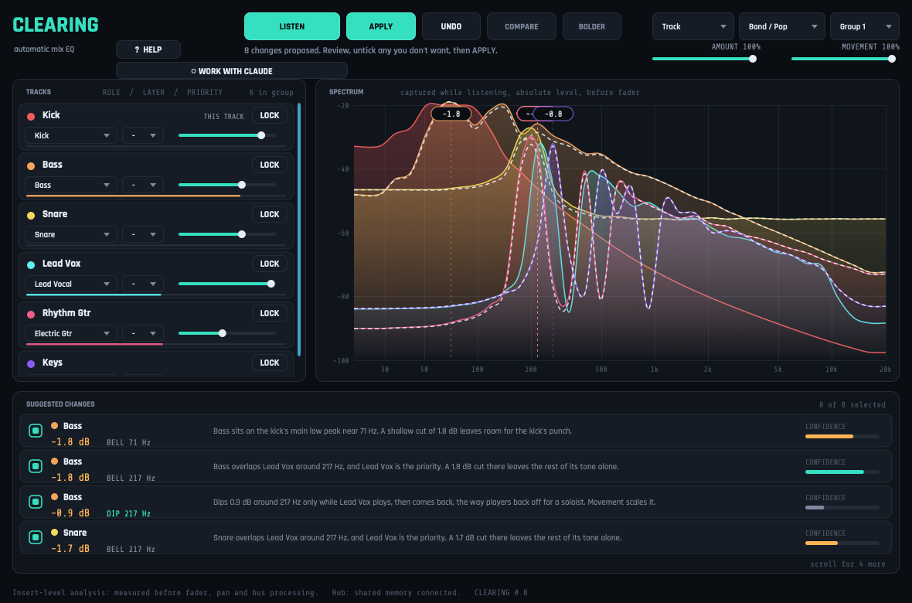

# CLEARING

Automatic mix EQ for Logic Pro (Audio Unit, Apple Silicon and Intel). Put one CLEARING on each track you want included. Any instance's window shows the whole mix: it listens across the song, finds where parts fight for the same frequencies, proposes small EQ moves with a reason for each, and applies the ones you accept. It can also look at levels, and (optionally) be driven by an AI assistant over MCP, while you watch every change it makes.

> Made by **Rob Cawley**, a musician in Dublin, for his own records, and shared free for anyone to try. It is an early version (0.8): expect rough edges, and tell me what you find.
> If you make something with it, I'd love to hear it. Post it anywhere, and if you like, link back to my music:
> **[robcawley.com](https://robcawley.com)** · **[Bandcamp](https://robcawley.bandcamp.com)** · the new album **[Room Tone](https://robcawley.com/roomtone/)**.

## How it works

1. Insert CLEARING on each participating track, after its tone-shaping effects (and one on the stereo out, set to **Master out**, if you want level and mix-health measurements).
2. In any CLEARING window, set each track's **role**, **priority** and **lock**, and pick **Band / Pop** or **Orchestral**.
3. Press **LISTEN**, play the busiest material for 30–60 seconds, then **STOP**.
4. Review the suggestions. Untick any you don't want and press **APPLY**. **COMPARE** bypasses everything (level-matched, so you're judging tone, not loudness). **AMOUNT** scales every accepted move. **UNDO** reverts the whole mix in one step.
5. Save the Logic project. Each instance stores its accepted EQ, so bounces don't need the window open.

## What it does

- **Masking fixes between parts.** Parts that crowd the same range give way to the one with priority, with small, explained cuts (and, where it helps, boosts).
- **Layers.** Tracks that make one sound (L1–L8) are judged and corrected as one instrument.
- **Movement.** Supporting parts ease back around a focus part's range only while it plays, like players backing off for a soloist. Section leads can be named per section.
- **Self-triggered dynamic EQ.** Bands that jump far above their norm (boom, harshness, sibilance, by role) are cut only while they rise. A whole-part crescendo doesn't trigger it.
- **Sections and arrangement.** Mark the sections of a song and how each should feel; Amount and Movement follow them. Per-bar analysis shows who owns each band in each section.
- **Levels and balance.** Each track has an automatable **Trim**. `balance_mix` compares each part's loudness at the stereo out with a target ladder for the style (industrial, rock, pop, electronic, hip hop, orchestral, ambient), with the lead placed on top, blended or inside the mix. It proposes whole-song moves and per-section rides, each with a reason, and flags gain-staging problems (inserts peaking near 0 dBFS, very quiet sources, faders pulled well down, a hot stereo out).
- **Mix health** (on the stereo out): L/R correlation and mono survival by band and bar, true peak, integrated loudness, and energy no CLEARING track accounts for.
- **Harmonics.** Surgical saturation per track, for example harmonic bass that makes a low fundamental read on small speakers.
- **Pictures.** Arrangement map, masking by section, spectrum, stereo and balance views, as PNGs.
- Everything is undoable, saved with the project, and the automatable parameters (Amount, Movement, Bypass and Trim) glide without clicks. Up to 32 tracks, 6 bands per track.

## Working with an AI assistant (optional)

CLEARING works fine on its own. If you like, it also ships a local [MCP](https://modelcontextprotocol.io) server, `clearing-mcp` (stdio), so an AI assistant that supports MCP can run a session the way a mix engineer would: list the tracks, ask you what each part is and how the arrangement should feel, listen while you play, explain the suggestions, and apply the ones you agree to. It only talks to the CLEARING instances, so it can't see tracks without CLEARING on them, can't insert plug-ins and can't press play. A **WORK WITH CLAUDE** chip in the window shows whether an assistant is connected, what it is doing, and a list of everything it changed.

Tools: `status`, `list_tracks`, `list_roles`, `set_track`, `get_brief`, `set_brief`, `set_sections`, `set_section_lead`, `listen`, `get_suggestions`, `apply`, `add_dip` / `remove_dip`, `clear_eq`, `undo`, `set_amount`, `set_movement`, `compare`, `analyse_arrangement`, `render_view`, `set_trim`, `mix_health`, `set_harmonics`, `balance_mix`.

- **Claude desktop:** `./install.sh` adds the connector to its config if it's missing (backing the config up first).
- **Claude Code:** `claude mcp add clearing /path/to/clearing-mcp`
- **Any other MCP client:** run `clearing-mcp` with no arguments.
- **No MCP client?** The bridge works from the terminal: `clearing status`, `clearing tools`, `clearing call <tool> [json]`, `clearing prompt` (a briefing to paste into any assistant), `clearing serve --http 7811` (local only).

## Download

Get the ready-built plug-in (and the MCP server and bridge) from the **[latest release](https://github.com/robcawley/clearing/releases/latest)** (macOS 12 or later, Apple Silicon and Intel).

1. Unzip it and move `CLEARING.component` into `~/Library/Audio/Plug-Ins/Components` (in Finder: Go → Go to Folder…, then paste that path).
2. The plug-in isn't signed with an Apple developer certificate, so macOS blocks it the first time. Open Terminal and run:

       xattr -dr com.apple.quarantine ~/Library/Audio/Plug-Ins/Components/"CLEARING.component"

3. Restart Logic. It appears under Audio FX → Audio Units → Rob Cawley → CLEARING.
4. Optional, for the assistant: see `tools/README.txt` in the zip.

After you update to a new version, quit and reopen Logic once, because the shared-memory segment that links the instances changes between versions.

## Build from source

You need a Mac with the Xcode Command Line Tools and CMake.

    git clone https://github.com/robcawley/clearing.git
    cd clearing
    git clone --branch 8.0.4 --depth 1 https://github.com/juce-framework/JUCE.git JUCE
    ./install.sh

`install.sh` builds the plug-in, the MCP server and the checks, installs and ad-hoc signs the plug-in, runs `auval`, installs the bridge, and registers the connector with Claude desktop if that app is installed. Build only the `Clearing_AU` target if you just want the plug-in.

The checks are in `Tools/`: `ClearingCoreCheck` (planner and DSP), `ClearingHubCheck` (two real processes), `ClearingSnapshot` (renders the real window to PNG headlessly), and `mcp_session_test.py` and `bridge_test.py`, which drive the MCP server against `ClearingFakeSession`, a stand-in Logic session.

## Limits

- Analysis happens at each instance's insert, before the fader, pan and buses. Re-listen after big balance changes; the stereo-out instance fits the faders and buses back in for the level tools.
- CLEARING proposes small, explained moves, and level moves are limited to 6 dB in total.
- Instances find each other through shared memory (POSIX). That works across processes in the tests; behaviour inside every Logic setup isn't exhaustively checked.
- Apple Silicon is what I test on. Universal builds, but Intel is untested.

## Sister projects

- [UNDERTOW](https://github.com/robcawley/undertow): an ambient space effect.
- [NEON RIOT](https://github.com/robcawley/neon-riot): a heavy bass synthesizer.
- [ROB KIT](https://github.com/robcawley/rob-kit): a human-feeling drum instrument.
- [BRUISER](https://github.com/robcawley/bruiser): a drummer that plays ROB KIT.
- [THE GREAT COMPOSER](https://github.com/robcawley/the-great-composer): chords in, orchestral MIDI out.

## Licence

AGPL-3.0 (see `LICENSE`), the same open-source licence as the JUCE framework it's built on. Fonts: Rajdhani and Share Tech Mono, SIL Open Font Licence.
